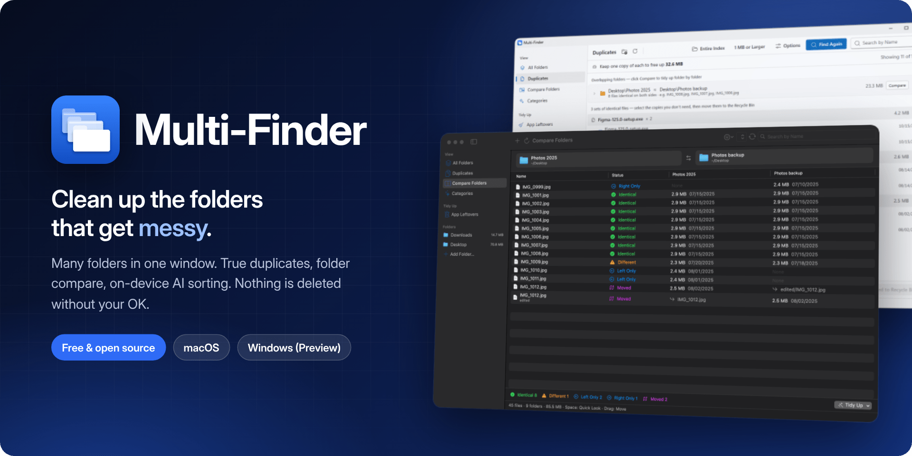
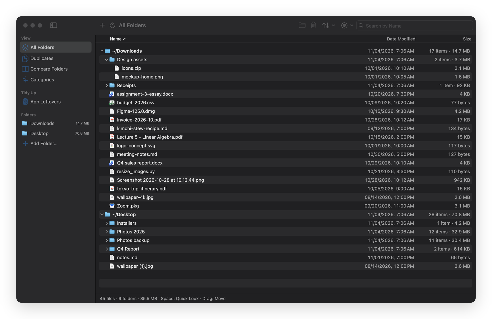
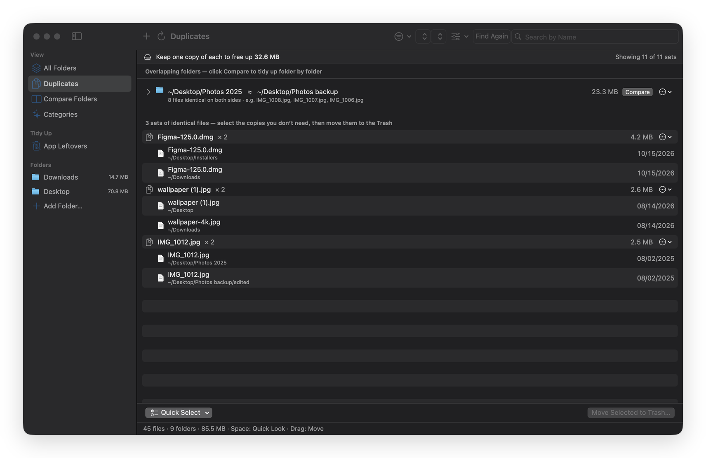
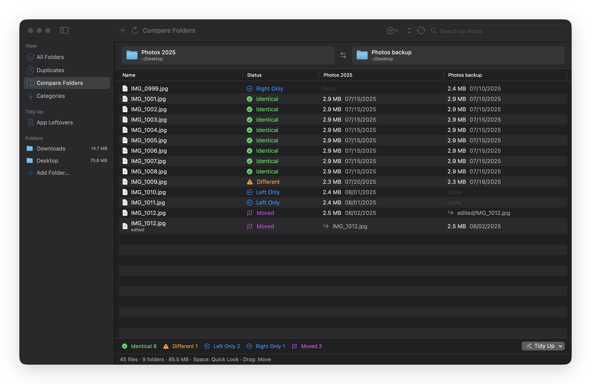
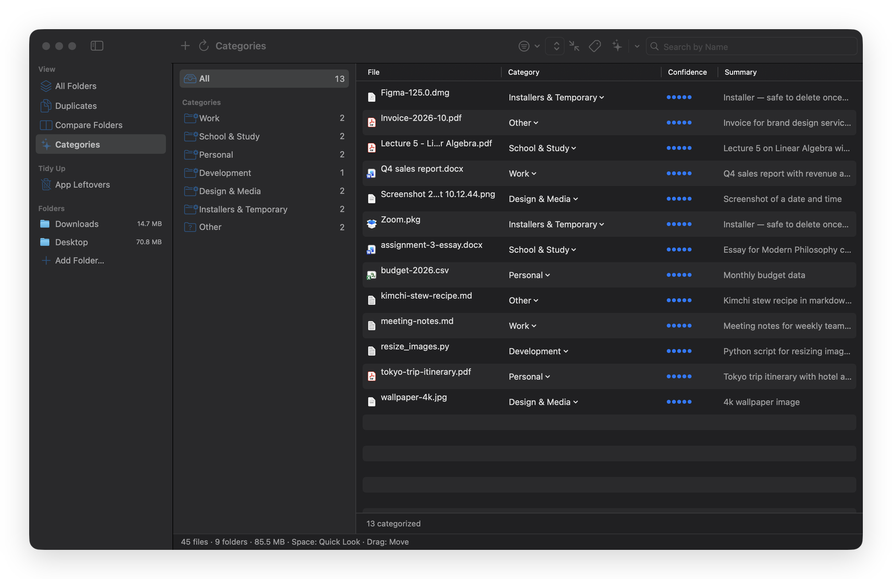
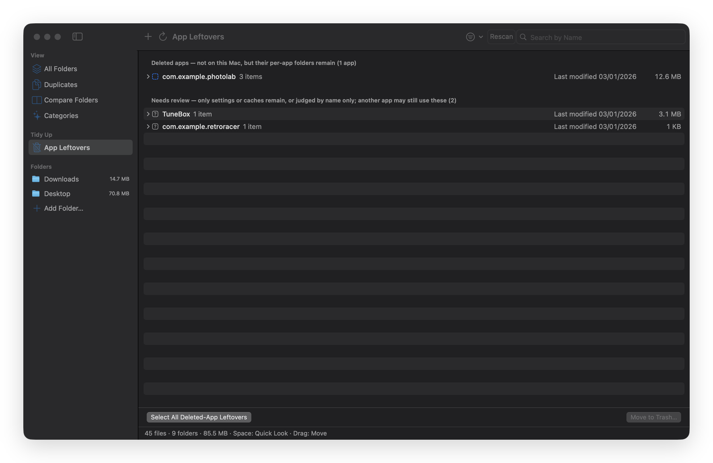
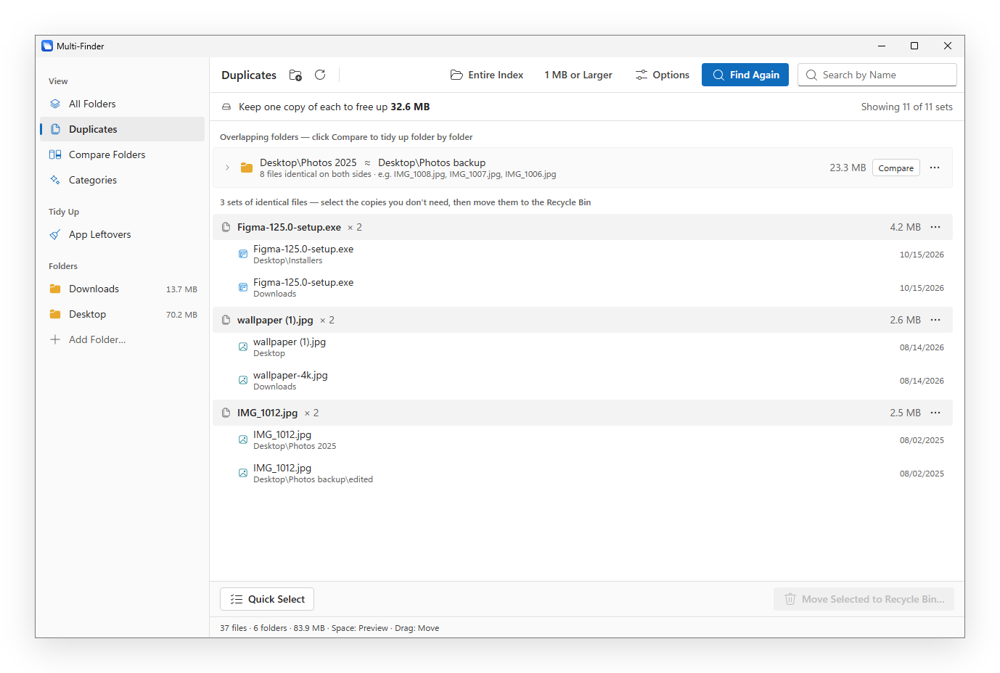

<p align="center">
  
</p>

<p align="center">
  <a href="https://github.com/uteeddevelopers/Multi-Finder/releases/download/v1.0.0/Multi-Finder-1.0.0.dmg"></a>
  &nbsp;
  <a href="https://github.com/uteeddevelopers/Multi-Finder/releases/download/windows-v1.0.0-preview/Multi-Finder-1.0.0-Windows-Setup.exe"></a>
</p>

<p align="center">
  
  
  <a href="LICENSE"></a>
  
  <a href="https://github.com/sponsors/uteeddevelopers"></a>
</p>

<p align="center"><a href="README.md">English</a> · <b>한국어</b></p>

---

다운로드 폴더에는 설치 파일과 스크린샷이 쌓이고, 바탕화면에는 '최종(2)' 같은 사본이 늘어납니다. 사진 백업은 어느새 원본과 달라져 있고, 몇 년 전에 지운 앱의 폴더가 아직 Library에 남아 있습니다. Finder와 탐색기는 한 번에 폴더 하나만 보여 주니, 전체가 얼마나 어지러운지 한눈에 볼 방법이 없습니다.

**Multi-Finder는 이 모두를 한 창에 모아 보여 주고, 안전하게 정리하도록 도와줍니다.** 내용이 완전히 같은 파일을 찾고, 두 폴더가 어떻게 다른지 보여 주고, 내 컴퓨터 안에서 도는 AI 모델로 문서를 내용대로 나누고, 지운 앱이 남긴 흔적을 찾아 줍니다. 바로 지우는 일은 없습니다. 파일은 휴지통으로만 가고, 되돌리기 한 번이면 정리한 것이 통째로 돌아옵니다.

<br>

## 할 수 있는 일

### 여러 폴더를 한 목록으로



다운로드, 바탕화면, 프로젝트 폴더, 외장 디스크를 추가하면 Finder처럼 생긴 한 트리에서 함께 볼 수 있습니다. 형식·크기·기간으로 거르고, 모든 폴더를 한 번에 검색하고, 파일을 폴더 위로 끌어 옮기고, <kbd>스페이스</kbd>로 미리 봅니다.

### 중복 파일: 이름이 아니라 내용으로



이름이나 위치가 달라도 바이트 하나까지 같아야 중복으로 봅니다. 같은 프로젝트 안에 있어야 하는 사본은 숨기고, 통째로 겹치는 폴더는 한 줄로 묶고, **묶음마다 하나는 반드시 남깁니다**. 실수로 전부 고를 수 없습니다.

### 두 폴더 비교



폴더와 그 백업을 나란히 놓으면 파일마다 동일한지, 다른지, 한쪽에만 있는지, 다른 자리로 옮겨졌는지 보여 줍니다. 빠진 파일을 반대쪽으로 옮기거나 한쪽의 남는 사본을 한 번에 치울 수 있습니다.

### 자동 분류: 내용을 읽고 나누기



내 컴퓨터에서 도는 AI 모델이 PDF, 워드, 텍스트 파일을 읽고 내가 정한 묶음(업무, 학교·공부, 개인 등)에 하나씩 넣습니다. 파일은 옮기라고 하기 전까지 제자리에 있고, 내용은 컴퓨터 밖으로 나가지 않습니다.

- **macOS:** Apple Intelligence (macOS 26 이상)
- **Windows:** 작은 공개 모델(Qwen3, 약 800MB)을 처음 쓸 때 한 번 내려받음

### 지운 앱의 잔여물



지운 앱이 `~/Library`(Windows는 `AppData`)에 남긴 설정, 캐시, 컨테이너를 찾습니다. 확실한 것과 확인이 필요한 것을 나눠 보여 주고, 애매한 것은 건드리지 않습니다.

<br>

## 안전하게 만들었습니다

<table>
  <tr>
    <td width="33%" valign="top"><b>바로 지우지 않음</b><br>확인을 거친 뒤에만, 휴지통으로만 옮깁니다.</td>
    <td width="33%" valign="top"><b>한 번에 되돌리기</b><br><kbd>⌘Z</kbd> / <kbd>Ctrl</kbd>+<kbd>Z</kbd> 한 번으로 정리한 것 전체가 돌아옵니다.</td>
    <td width="33%" valign="top"><b>덮어쓰지 않음</b><br>같은 이름의 파일이 이미 있으면 그 파일은 건너뜁니다.</td>
  </tr>
  <tr>
    <td valign="top"><b>중복은 하나 남김</b><br>어떤 묶음이든 최소 한 개는 남깁니다.</td>
    <td valign="top"><b>개인정보</b><br>계정도 추적도 없습니다. 파일 내용은 컴퓨터 밖으로 나가지 않습니다.</td>
    <td valign="top"><b>오픈소스</b><br>GPL-3.0. 코드 전체가 이 저장소에 있습니다.</td>
  </tr>
</table>

<br>

## 내려받기와 설치

### macOS

1. **[Multi-Finder-1.0.0.dmg](https://github.com/uteeddevelopers/Multi-Finder/releases/download/v1.0.0/Multi-Finder-1.0.0.dmg)**(1.9MB)를 받아 Multi-Finder를 응용 프로그램 폴더로 끌어 놓으세요.
2. 한 번 실행하세요. 아직 애플 공증 전이라 macOS가 앱을 확인할 수 없다고 안내합니다. **완료**를 누르세요.
3. **시스템 설정 › 개인정보 보호 및 보안**에서 아래로 내려 Multi-Finder 옆의 **확인 없이 열기**를 누르세요. 처음 한 번만 하면 됩니다.

macOS 14 Sonoma 이상(Apple 실리콘·인텔). 자동 분류는 Apple Intelligence가 켜진 macOS 26이 필요합니다.
선택: 다른 앱 데이터 폴더 안의 잔여물을 지우거나 휴지통 이동을 <kbd>⌘Z</kbd>로 되돌리려면 **시스템 설정 › 개인정보 보호 및 보안 › 전체 디스크 접근**에서 Multi-Finder를 켜세요.

### Windows (미리보기)

1. **[Multi-Finder-1.0.0-Windows-Setup.exe](https://github.com/uteeddevelopers/Multi-Finder/releases/download/windows-v1.0.0-preview/Multi-Finder-1.0.0-Windows-Setup.exe)**(6MB)를 받으세요. 설치 없이 쓰려면 **[바로 실행 파일](https://github.com/uteeddevelopers/Multi-Finder/releases/download/windows-v1.0.0-preview/Multi-Finder-1.0.0-Windows-Portable.exe)**을 받으면 됩니다.
2. 아직 코드 서명 전이라 *'Windows의 PC 보호'* 창이 뜰 수 있습니다. **추가 정보 › 실행**을 누르세요.

Windows 10·11(64비트), Microsoft Edge WebView2가 필요합니다. Windows 11에는 기본으로 들어 있고, Windows 10에 없으면 설치 파일이 함께 설치합니다.

> [!NOTE]
> Windows판은 새로 나온 버전입니다. Windows 자동 테스트는 통과했지만, 아직 많은 사람이 써 보지는 않았습니다. 이상한 점이 보이면 [이슈로 알려 주세요](https://github.com/uteeddevelopers/Multi-Finder/issues).

<p align="center"></p>

릴리스마다 내려받을 파일의 SHA-256 체크섬을 함께 적어 둡니다.

<br>

## 자주 묻는 질문

<details>
<summary><b>정말 무료인가요?</b></summary>
<br>
네. 광고도, 계정도, 유료 기능도 없습니다. GPL-3.0 오픈소스이고, <a href="#후원">후원</a>해 주시는 분들 덕분에 이어 갑니다.
</details>

<details>
<summary><b>처음 열 때 왜 경고가 뜨나요?</b></summary>
<br>
애플 공증과 Windows 코드 서명에는 유료 개발자 인증서가 필요한데, 아직 갖추지 못했습니다. 경고는 애플이나 마이크로소프트의 확인을 거치지 않았다는 뜻이지, 해로운 것이 발견됐다는 뜻이 아닙니다. 코드는 모두 이 저장소에 있고, 릴리스마다 SHA-256 체크섬으로 내려받은 파일을 확인할 수 있습니다.
</details>

<details>
<summary><b>중요한 파일을 실수로 지울 수도 있나요?</b></summary>
<br>
앱이 파일을 직접 지우는 일은 없습니다. 지우기는 언제나 확인을 거쳐 휴지통으로 옮기는 것이고, <kbd>⌘Z</kbd> / <kbd>Ctrl</kbd>+<kbd>Z</kbd>로 그 작업 전체를 되돌릴 수 있습니다. 중복 파일은 묶음마다 하나를 남기고, 앱 잔여물은 확실한 것만 보여 줍니다.
</details>

<details>
<summary><b>내 파일을 어딘가로 올리나요?</b></summary>
<br>
아니요. 스캔, 중복 확인, 자동 분류 모두 내 컴퓨터 안에서 합니다. 내려받는 것은 Windows판이 자동 분류를 처음 쓸 때 Hugging Face에서 한 번 받는 AI 모델뿐입니다.
</details>

<details>
<summary><b>어떤 언어로 쓸 수 있나요?</b></summary>
<br>
한국어, 영어, 일본어, 중국어 간체입니다. 시스템 언어를 따르고, 목록에 없는 언어면 영어로 보입니다.
</details>

<br>

## 후원

Multi-Finder는 한 사람이 만들고 있습니다. 시간을 아껴 드렸다면 **[GitHub Sponsors](https://github.com/sponsors/uteeddevelopers)**로 응원해 주세요. 후원금은 처음 열 때 뜨는 경고를 없애 줄 개발자 인증서 비용과 새 기능·수정에 보탭니다. 저장소에 별(Star)을 눌러 주시거나 [버그를 알려 주시는 것](https://github.com/uteeddevelopers/Multi-Finder/issues)도 큰 힘이 됩니다. 고맙습니다!

<br>

## 직접 빌드하기

**macOS** (Xcode 26 이상)

```sh
swift test
scripts/build-app.sh --run    # build/Multi-Finder.app
scripts/make-dmg.sh           # dist/Multi-Finder-<버전>.dmg
```

**Windows** (Node 22, Rust, Visual Studio C++ 빌드 도구, CMake), `windows/` 폴더에서

```sh
npm ci
cargo test -p mf-core --release
npx tauri build               # target/release/bundle/nsis/*-setup.exe
```

Windows판의 구조는 [windows/README.md](windows/README.md)와 [windows/SPEC.md](windows/SPEC.md)에 있습니다.

<br>

## 라이선스

[GPL-3.0](LICENSE) © 2026 Taeho Lim
