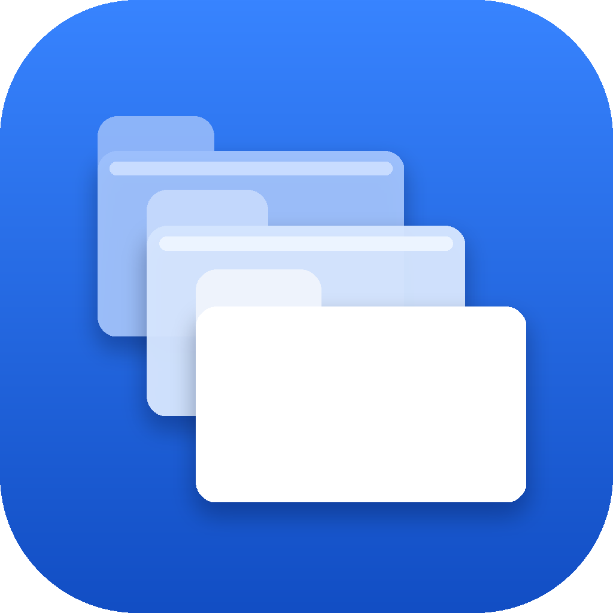

<p align="center"></p>
<h1 align="center">Multi-Finder</h1>
<p align="center">
  A free, native macOS file manager for the folders that get messy.<br>
  English · 한국어 · 日本語 · 简体中文 — follows your Mac's language.
</p>
<p align="center">
  <a href="https://github.com/uteeddevelopers/Multi-Finder/releases/latest"><b>⬇︎ Download for macOS</b></a> ·
  <a href="#support">♥ Support</a> ·
  <a href="#한국어">한국어</a>
</p>


## What it does

- **All Folders** — several folders in one Finder-style list. Filter by kind, size and date, search all of them at once, drag to move, Quick Look with Space.
- **Duplicates** — files whose contents are byte-for-byte identical, wherever they are. Copies inside the same project are hidden, overlapping folders fold into a single row, and one copy of every set is always kept.
- **Compare Folders** — two folders side by side: identical, different, only on one side, or moved. Move the one-sided files across, or clear one side's copies.
- **Categories** — Apple's on-device model (Foundation Models) reads your files and sorts them into categories you define. Files stay where they are until you choose to move them.
- **App Leftovers** — settings, caches and containers that deleted apps left behind in `~/Library`. Clear-cut ones are kept apart from the ones that need a look, and anything uncertain is left alone.

Nothing is ever deleted outright: files go to the Trash only after you confirm, and ⌘Z undoes a whole action in one step. File contents never leave your Mac.

| Duplicates | Compare Folders |
|---|---|
|  |  |

## Install

1. Download the `.dmg` from [Releases](https://github.com/uteeddevelopers/Multi-Finder/releases/latest) and drag Multi-Finder into Applications.
2. The app isn't notarized by Apple yet, so macOS blocks the first launch. Open **System Settings › Privacy & Security**, scroll down and click **Open Anyway** next to Multi-Finder, then confirm. You only do this once.
3. Optional: to remove leftovers inside other apps' data folders, or to undo a Move to Trash with ⌘Z, turn on Multi-Finder in **System Settings › Privacy & Security › Full Disk Access**.

Requires macOS 14 or later, Apple silicon or Intel. Categories needs macOS 26 with Apple Intelligence.
Each release lists the SHA-256 of its download.

## Support

Multi-Finder is free and open source. If it saves you time, you can support its development through **[GitHub Sponsors](https://github.com/sponsors/uteeddevelopers)** (the ♥ Sponsor button at the top of this page). Thank you!

## Build from source

```sh
swift test
scripts/build-app.sh --run    # build/Multi-Finder.app
scripts/make-dmg.sh           # dist/Multi-Finder-<version>.dmg
```

Requires Xcode 26 or later. UI strings live in `Packaging/Localizable.xcstrings` (the keys are the Korean source text); `scripts/update-strings.sh` syncs the catalog with the code and lists missing translations.

<details>
<summary>Project layout</summary>

```
Sources/MultiFinderCore   Scanner · ScanRules · ContentHasher · IndexStore (SQLite)
                          DuplicateFinder · DuplicateAnalyzer · FolderDiff
                          Executor (move / trash / undo, one batch per action) · Watcher (FSEvents)
                          TextExtractor (PDF, Office, OCR) · Classification · LeftoverFinder
Sources/MultiFinderApp    SwiftUI app — AppModel plus a model/view per screen, ClassifierEngine (Foundation Models)
Sources/MultiFinderCLI    mfinder — exercises the core from the terminal
Tests/MultiFinderCoreTests
Packaging/                Info.plist, icon, string catalogs, install guide
scripts/                  build-app.sh · make-dmg.sh · update-strings.sh
```

The index lives at `~/Library/Application Support/MultiFinder/index.sqlite`.
</details>

## License

[GPL-3.0](LICENSE) © 2026 Taeho Lim

---

## 한국어

맥의 어지러운 폴더를 위한 무료 파일 관리 앱입니다. macOS 언어에 맞춰 한국어·영어·일본어·중국어 간체로 자동 표시됩니다.

- **모아 보기** — 폴더 여러 개를 Finder 목록처럼 한 화면에. 형식·크기·기간 필터, 전체 검색, 끌어 놓기 이동, 스페이스로 미리보기
- **중복 파일** — 이름·위치가 달라도 내용이 완전히 같은 파일. 같은 프로젝트 안의 반복은 숨기고, 묶음마다 하나는 반드시 남깁니다
- **폴더 비교** — 두 폴더를 나란히: 동일·다름·한쪽에만·자리만 다름. 한쪽으로 몰기, 겹치는 쪽 치우기
- **자동 분류** — Apple 온디바이스 모델이 파일 내용을 읽어 내가 정한 묶음에 나눕니다. 파일은 제자리에 둡니다
- **앱 잔여물** — 지운 앱이 `~/Library`에 남긴 설정·캐시·컨테이너. 애매하면 남깁니다

바로 지우는 일은 없습니다. 확인을 거쳐 휴지통으로만 옮기고, ⌘Z 한 번으로 되돌립니다. 파일 내용은 Mac 밖으로 나가지 않습니다.

**설치** — [Releases](https://github.com/uteeddevelopers/Multi-Finder/releases/latest)에서 `.dmg`를 받아 응용 프로그램 폴더로 끌어 놓으세요. 아직 애플 공증 전이라 처음 한 번은 **시스템 설정 › 개인정보 보호 및 보안**에서 아래로 내려 Multi-Finder 옆의 **확인 없이 열기**를 눌러야 합니다. macOS 14 이상(Apple 실리콘·인텔), 자동 분류는 macOS 26 + Apple Intelligence가 필요합니다.

**후원** — Multi-Finder는 무료 오픈소스입니다. 도움이 되셨다면 [GitHub Sponsors](https://github.com/sponsors/uteeddevelopers)(이 페이지 위의 ♥ Sponsor 버튼)로 개발을 응원해 주세요.
