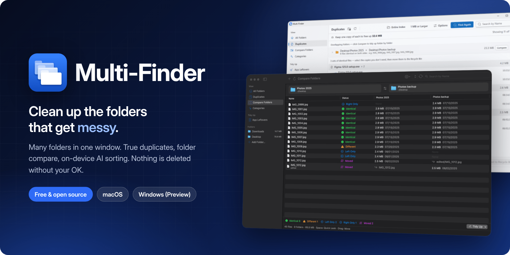
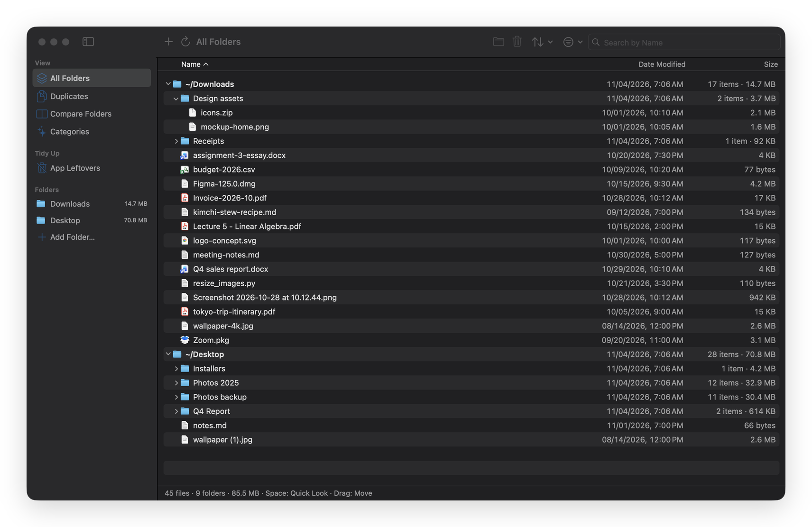
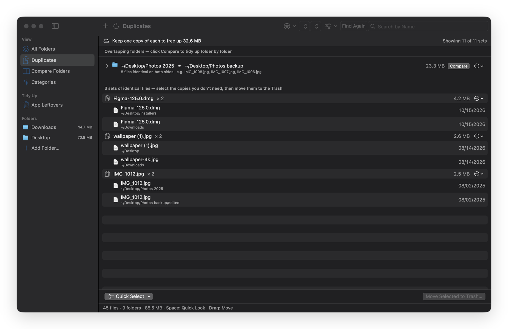
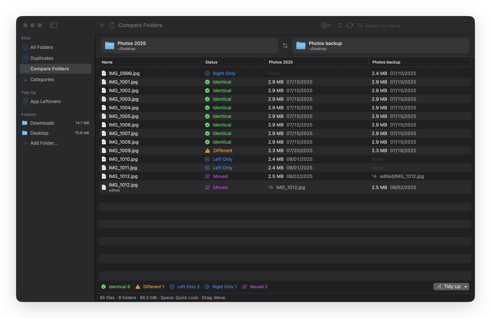
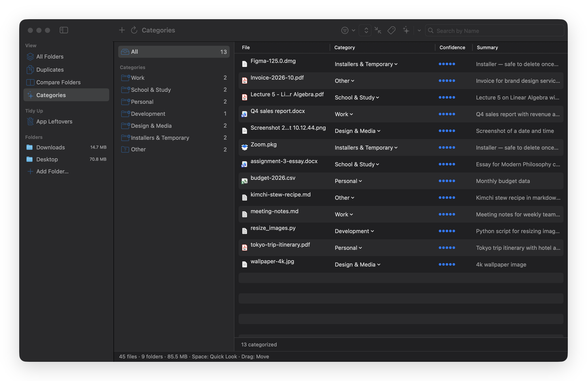
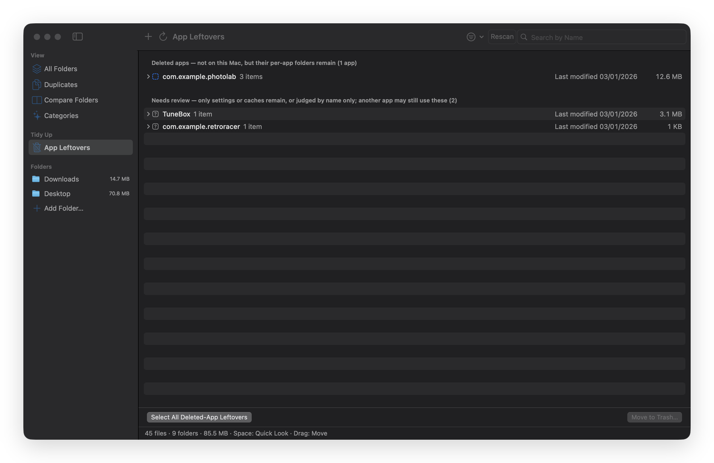
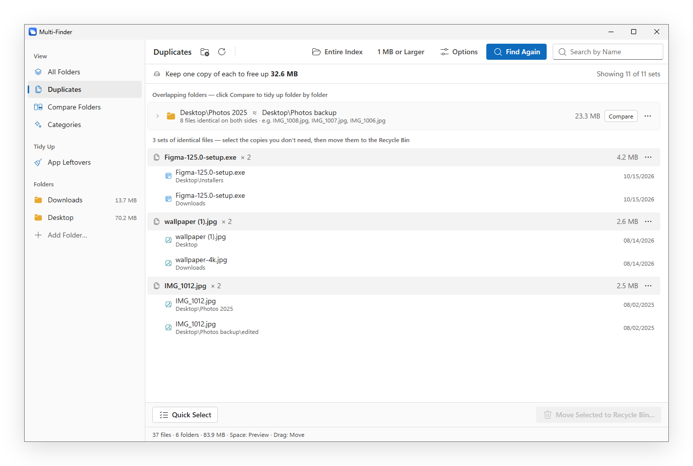

<p align="center">
  
</p>

<p align="center">
  <a href="https://github.com/uteeddevelopers/Multi-Finder/releases/download/v1.0.0/Multi-Finder-1.0.0.dmg"></a>
  &nbsp;
  <a href="https://github.com/uteeddevelopers/Multi-Finder/releases/download/windows-v1.0.0-preview/Multi-Finder-1.0.0-Windows-Setup.exe"></a>
</p>

<p align="center">
  
  
  <a href="LICENSE"></a>
  
  <a href="https://github.com/sponsors/uteeddevelopers"></a>
</p>

<p align="center"><b>English</b> · <a href="README.ko.md">한국어</a></p>

---

Downloads fills up with installers and screenshots. The Desktop collects copies called *final (2)*. A photo backup slowly drifts away from the original. Apps you deleted years ago still keep folders in your Library. Finder and Explorer show one folder at a time, so you never see the whole mess at once.

**Multi-Finder puts all of it in one window and helps you clean it up, carefully.** It finds files that are truly identical, shows exactly how two folders differ, sorts documents by what's inside with an AI model that runs on your own computer, and lists what uninstalled apps left behind. Nothing is deleted outright: files go to the Trash, and one undo brings a whole cleanup back.

<br>

## What it does

### All your folders in one list



Add Downloads, Desktop, a project folder or an external drive and browse them together in one Finder-style tree. Filter by kind, size and date, search every folder at once, drag files onto a folder to move them, and press <kbd>Space</kbd> to preview.

### Duplicates, matched by content



Two files are duplicates only when every byte matches, whatever they're called and wherever they live. Copies that belong inside the same project are hidden, whole folders that overlap collapse into a single row, and **one copy of every set is always kept**, so you can't select them all by accident.

### Compare two folders



Put a folder next to its backup and see every file as identical, different, only on one side, or moved somewhere else. Copy the missing files across or clear one side's extra copies in one step.

### Categories, sorted by what's inside



An AI model running on your computer reads PDFs, Word and text files and puts each one into a category you define: Work, School & Study, Personal, or your own. Files stay where they are until you choose to move them, and their contents never leave your computer.

- **macOS:** Apple Intelligence (macOS 26 or later)
- **Windows:** a small open model (Qwen3, about 800 MB), downloaded once the first time you use it

### Leftovers from deleted apps



Settings, caches and containers that deleted apps left in `~/Library` (or `AppData` on Windows). Clear-cut leftovers are listed apart from the ones that need a look, and anything uncertain is left alone.

<br>

## Built to be safe

<table>
  <tr>
    <td width="33%" valign="top"><b>Nothing is deleted outright</b><br>Files go to the Trash or Recycle Bin, and only after you confirm.</td>
    <td width="33%" valign="top"><b>One undo per action</b><br><kbd>⌘Z</kbd> / <kbd>Ctrl</kbd>+<kbd>Z</kbd> brings back a whole cleanup, not just the last file.</td>
    <td width="33%" valign="top"><b>Never overwrites</b><br>If a file with the same name is already there, that file is skipped.</td>
  </tr>
  <tr>
    <td valign="top"><b>Duplicates keep one copy</b><br>Every set keeps at least one file, always.</td>
    <td valign="top"><b>Private</b><br>No account and no tracking. File contents never leave your computer.</td>
    <td valign="top"><b>Open source</b><br>GPL-3.0. Every line is in this repository.</td>
  </tr>
</table>

<br>

## Download and install

### macOS

1. Download **[Multi-Finder-1.0.0.dmg](https://github.com/uteeddevelopers/Multi-Finder/releases/download/v1.0.0/Multi-Finder-1.0.0.dmg)** (1.9 MB) and drag Multi-Finder into Applications.
2. Open it once. Because the app isn't notarized by Apple yet, macOS says it can't verify it. Click **Done**.
3. Open **System Settings › Privacy & Security**, scroll down and click **Open Anyway** next to Multi-Finder. You only do this once.

Requires macOS 14 Sonoma or later, on Apple silicon or Intel. Categories needs macOS 26 with Apple Intelligence turned on.
Optional: to clean leftovers inside other apps' data folders, or to undo a Move to Trash with <kbd>⌘Z</kbd>, turn on Multi-Finder in **System Settings › Privacy & Security › Full Disk Access**.

### Windows (Preview)

1. Download **[Multi-Finder-1.0.0-Windows-Setup.exe](https://github.com/uteeddevelopers/Multi-Finder/releases/download/windows-v1.0.0-preview/Multi-Finder-1.0.0-Windows-Setup.exe)** (6 MB), or the **[portable .exe](https://github.com/uteeddevelopers/Multi-Finder/releases/download/windows-v1.0.0-preview/Multi-Finder-1.0.0-Windows-Portable.exe)** if you'd rather not install anything.
2. Windows may show *"Windows protected your PC"*, because the app isn't code-signed yet. Click **More info › Run anyway**.

Requires Windows 10 or 11 (64-bit) with Microsoft Edge WebView2, which is built into Windows 11 and added by the installer on Windows 10 if it's missing.

> [!NOTE]
> The Windows version is new. It passes automated tests on Windows, but it hasn't been used widely yet. If something looks wrong, please [open an issue](https://github.com/uteeddevelopers/Multi-Finder/issues).

<p align="center"></p>

Every release lists the SHA-256 checksum of each download.

<br>

## Questions

<details>
<summary><b>Is it really free?</b></summary>
<br>
Yes. There are no ads, accounts or paid tiers. Multi-Finder is open source under GPL-3.0 and kept going by people who choose to <a href="#support">support it</a>.
</details>

<details>
<summary><b>Why does my Mac or PC warn me the first time I open it?</b></summary>
<br>
Apple notarization and Windows code signing require paid developer certificates that this project doesn't have yet. The warning means the app hasn't been checked by Apple or Microsoft, not that anything harmful was found. The source code is all here, and each release lists SHA-256 checksums so you can confirm your download.
</details>

<details>
<summary><b>Could it delete something important by mistake?</b></summary>
<br>
It never deletes files itself. Removing a file always means moving it to the Trash or Recycle Bin, always after a confirmation, and <kbd>⌘Z</kbd> / <kbd>Ctrl</kbd>+<kbd>Z</kbd> undoes the whole action. Duplicates always leave one copy of each file, and App Leftovers only lists items it is confident about.
</details>

<details>
<summary><b>Does it upload my files anywhere?</b></summary>
<br>
No. Scanning, duplicate checks and categories all run on your computer. The only download is the AI model on Windows, fetched once from Hugging Face when you first use Categories.
</details>

<details>
<summary><b>Which languages does it speak?</b></summary>
<br>
English, Korean, Japanese and Simplified Chinese. It follows your system language and falls back to English.
</details>

<br>

## Support

Multi-Finder is made by one person. If it saves you time, you can support it through **[GitHub Sponsors](https://github.com/sponsors/uteeddevelopers)**. Sponsorships help pay for the developer certificates that would make the first-launch warnings go away, and for time spent on new features and fixes. Starring the repository and [reporting bugs](https://github.com/uteeddevelopers/Multi-Finder/issues) help too. Thank you!

<br>

## Build from source

**macOS** (Xcode 26 or later)

```sh
swift test
scripts/build-app.sh --run    # build/Multi-Finder.app
scripts/make-dmg.sh           # dist/Multi-Finder-<version>.dmg
```

**Windows** (Node 22, Rust, Visual Studio C++ build tools, CMake), from `windows/`

```sh
npm ci
cargo test -p mf-core --release
npx tauri build               # target/release/bundle/nsis/*-setup.exe
```

See [windows/README.md](windows/README.md) and [windows/SPEC.md](windows/SPEC.md) for how the Windows version is put together.

<details>
<summary>Project layout</summary>

```
Sources/MultiFinderCore     macOS core: scanner, SQLite index, duplicates, compare, undo, leftovers
Sources/MultiFinderApp      macOS app (SwiftUI) and the on-device classifier (Foundation Models)
Sources/MultiFinderCLI      mfinder, a command-line front end for the core
Packaging/                  Info.plist, icon, string catalogs (EN, KO, JA, ZH) and the install guide
scripts/                    build-app.sh · make-dmg.sh · update-strings.sh
windows/core                Windows core in Rust (mf-core), tested on Linux and Windows
windows/src-tauri           Windows app shell (Tauri 2)
windows/src                 Windows interface (React + Fluent UI)
```

UI strings live in `Packaging/Localizable.xcstrings`, with the Korean source text as keys. The Windows interface reuses the same catalog.
</details>

<br>

## License

[GPL-3.0](LICENSE) © 2026 Taeho Lim
